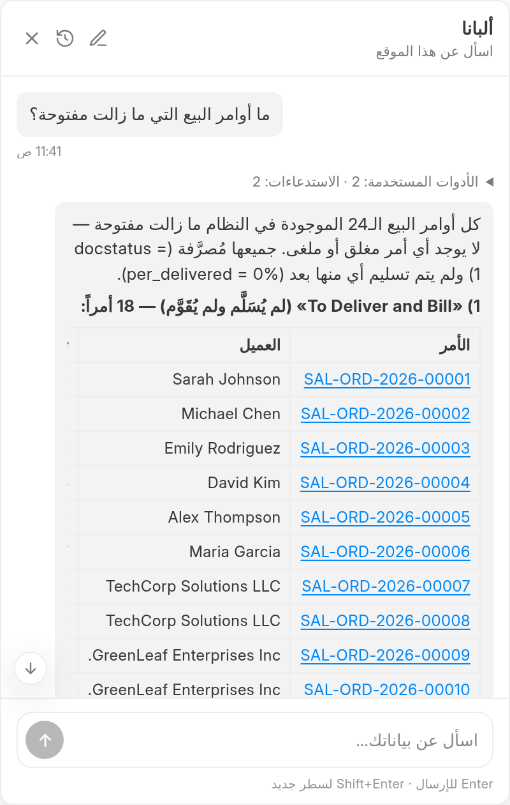

<div align="center">
  
</div>

# Albanna

**Ask your ERPNext data questions in plain language, and have it act on them.**

An ERPNext side chat: a panel that lives in the Desk, understands what page
you are looking at, and answers questions about the site's data — and acts on
it when you ask it to.

It is one Frappe app. There is no separate service, no gateway, no API key
per user, and no licence server. The ERPNext tools run **in-process**, inside
the Frappe request that opened the chat, so they see the same user, the same
roles and the same permissions as the person who asked the question.

```
┌─────────────────────────────────────────────────────────────────┐
│  Desk                                                          │
│  ┌────────────────────────┐        ┌────────────────────────┐  │
│  │ Sales Orders           │        │  Albanna               │  │
│  │ SAL-ORD-2026-00001     │        │  ┌──────────────────┐  │  │
│  │ …                      │        │  │ ▸ list_docs      │  │  │
│  │                        │  ◀───  │  │ 24 open orders   │  │  │
│  │                        │        │  │ 4,401,850 YER    │  │  │
│  └────────────────────────┘        │  └──────────────────┘  │  │
│                                    └────────────────────────┘  │
└─────────────────────────────────────────────────────────────────┘
```



## Install

```bash
bench get-app https://github.com/ahmedalbanna/albanna --branch main
bench --site <your-site> install-app albanna
bench --site <your-site> migrate
bench build --app albanna
```

Then open **Albanna Settings** and put a model provider's key in it. The
chat is off for everybody except System Managers until you widen it.

The app needs a model provider.  Any OpenAI-compatible endpoint works
(OpenRouter, OpenAI, Groq, vLLM, LM Studio, or a relay), as do Ollama and
Anthropic.  It has no other runtime dependency.

> **Frappe Cloud:** the Marketplace installs the app for you.  If you
> install it by hand on a Cloud site, use the `main` branch and run
> `bench --site <your-site> migrate` afterwards — the app ships its DocTypes
> in the repository, so the migration creates them.

## What it does

* **Six tools.** `list_docs`, `get_doc`, `get_doctype_meta`, `run_report`,
  `create_doc`, `update_doc`. The model is told about six tools, and only
  six.
* **One model provider at a time, with a fallback.** OpenAI-compatible
  (OpenRouter, OpenAI, Groq, vLLM, LM Studio), Ollama, or Anthropic.
* **A side chat, not a page.** A launcher on every Desk page; the panel
  docks beside the Desk rather than covering it.
* **Live progress.** The answer arrives as the model writes it, and one
  line says what the assistant is doing while it waits.  The tool calls
  are folded away behind that line, and open on demand.
* **A turn can be stopped.** The panel never leaves the reader watching a
  turn they have decided they do not want.  The work finishes on the
  server; the waiting stops in the browser.
* **A way in.** The empty state says which page — and which document —
  the assistant is looking at, and offers questions about *that*.
* **The answer is a doorway.** A document name in an answer is a link, and
  it opens the document.  The names that are linked are the ones the
  tools actually read, so nothing is guessed.
* **The answer is data, too.** A table in an answer copies as tab-separated
  values, so it pastes into a spreadsheet as a table.
* **A panel you can widen.** The answer's table is the one thing in here
  that is genuinely wide, so the panel can be dragged wider and the Desk
  gives up the space.  The width is remembered.
* **A history.** The panel lists the caller's conversations, and any of them
  can be reopened, renamed or deleted.  "New" starts a real new thread.
* **A turn you can take back.** The data a person asked about is theirs to
  erase, so a question that was asked wrongly can be removed from the
  thread — the question and the answer that followed it, together.
* **Private history.** A conversation belongs to the page it was started on
  and to the user who started it.
* **The panel follows the page.** Open it on a page you have used before
  and the thread is there, because it is the thread the assistant will
  answer in — and the question is asked about the page you are looking at
  *now*, not about the page the panel was opened on.  "New" starts a real
  one.
* **Arabic and right-to-left.** The interface follows the reader's
  direction, and the whole Desk in Arabic is a first-class case rather than
  an afterthought — the widget sits on the reading end of the screen, so it
  never covers the text being read.
* **An answer that was cut off says so.** When a provider stops at the
  token ceiling rather than finishing, the panel says so and the ledger
  records the turn as `truncated` — an answer that looks complete and
  is not is worse than one that admits it.
* **The provider's own options, in the operator's hands.** Options the
  app has no field for — a cache key, a vendor's own flag — are written
  as JSON in the settings and added to the request the app sends.
* **A ledger the operator can read.** Every turn is recorded — the model,
  the tokens, the cost, whether it worked — and the settings page sums
  the month: the turns, the tokens, the cost, and where they went, by
  model and by user.  The cost is in the site's own currency: the site
  prices a turn from its tokens, with the price per million tokens the
  settings carry.
* **An audit trail.** Every turn is recorded: who, which model, how many
  rounds, how many tool calls, what it cost. No question text, no answer
  text.

## Installing

```bash
bench get-app https://github.com/albanna/albanna --branch main
bench --site <site> install-app albanna
bench --site <site> migrate
bench build --app albanna
```

Then open **Albanna Settings** and put a model provider's key in it. The
chat is off for everybody except System Managers until you widen it.

```bash
sudo systemctl restart frappe-bench-frappe-web   # bench restart does not work here
```

## The architecture

Four layers, and the dependency arrow points one way, downwards:

```
api/        →  services/  →  {providers/, tools/}  →  core/
```

| Layer | What lives there | Rule |
|---|---|---|
| `api/` | whitelisted endpoints | thin; every one gates first |
| `services/` | the chat turn, persistence, settings | the only place the layers below are joined |
| `providers/` | LLM adapters | one per vendor; the only place a wire format exists |
| `tools/` | tool execution adapters | one per backend; the only place a tool is run |
| `core/` | the manifest, the authority, the message format | **imports no Frappe and nothing from the app** |

`core/` is free of Frappe on purpose. The interesting half of a chat app —
what a tool is, who may call it, what a turn looks like — is exactly the
half that is hard to test once a site is involved. Keeping it pure means
those tests run on a machine with no bench, no site and no network:

```bash
cd apps/albanna && ../../env/bin/python -m pytest
```

### Where the seams are

The design assumes the things it does today will change. Each one has a
named place to change:

| What will change | Where it changes |
|---|---|
| a sixth tool | one `ToolSpec` in `core/tools.py` + one function in `tools/erpnext.py` |
| a remote MCP backend instead of in-process | a new `tools/<name>.py` implementing the same port |
| a new model vendor | a new `providers/<name>.py` implementing `ChatProvider` |
| document Q&A / retrieval | a new source behind `services/context_service.py` |
| a guest or portal chat | a new interface + one rule in `core/authority.py` |
| different storage | behind `services/conversation_service.py` |

`tests/test_tool_manifest.py` fails if the manifest and the adapter name
different tools, so the first two rows of that table cannot drift.

## The six tools

| Tool | Tier | What it does |
|---|---|---|
| `list_docs` | read | find documents of one DocType |
| `get_doc` | read | read one document |
| `get_doctype_meta` | read | the fieldnames of a DocType |
| `run_report` | read | run an ERPNext report |
| `create_doc` | write | create a document |
| `update_doc` | write | change the fields of a document that exists |

The two writes are different rights, and the manifest says which:
`create_doc` is authorised against Frappe's `create` permission, and
`update_doc` against `write`. A role model that grants one does not
necessarily grant the other.

`update_doc` changes a document's **own** fields. It will not touch the
framework's fields (`owner`, `docstatus`, `name`), it will not touch a
read-only field, and it will not change a **submitted** document — the
form will not let a person do that either, and the refusal says so rather
than apologising for it.

`run_sql_query` is deliberately **absent**: it bypasses Frappe's permission
engine, including User Permissions and every row-level rule built on them.
A side chat is reachable by ordinary users, so a raw SELECT behind it is a
privilege escalation with a chat interface on top.

## Who may do what

Because the tools run in-process, the backend's role gate is gone and this
app owns the decision. It lives in `core/authority.py` and it is
**fail-closed**: an unknown tool, a switched-off tool, a missing role, a
write call whose target DocType is absent, and a permission checker that
raises are all a "no".

A tool the user may not reach is never *mentioned* to the model, so a turn
cannot be spent discovering that a tool is off-limits.

Writes run under the caller's real permissions. The tools are the app's
own, and they call the framework's own functions — `frappe.get_list`,
`frappe.get_doc`, `doc.insert()`, `doc.save()` — so the requesting user's
roles and User Permissions apply to every read and every write. A Sales
User cannot create a Sales Invoice through the chat even if the authority
layer were bypassed, because Frappe's permission engine refuses the insert
too.

## Configuration

**Albanna Settings** (System Manager only) holds:

| Group | Fields |
|---|---|
| Model provider | kind, base URL, model, API key, temperature, max tokens, timeout |
| Fallback | enabled, kind, base URL, model, API key |
| Widget | position |
| Limits | max tool rounds, history limit, turn timeout, turns per minute, disabled tools |
| Prompt | system prompt (blank uses the built-in one) |

Chat access starts closed: System Managers only.  To let others chat, grant
them the `Albanna User` role -- the same way any role is granted in
Frappe, through the User form.  The role grants read, write, create and
delete on `Albanna Conversation`, all of them `if_owner`, so a person
keeps their own conversations and nobody else's.  System Managers are
covered by the shipped rows and need no role.

### The write tools

There is no site-wide "allow writes" switch.  A person is offered
`create_doc` when their account may create at least one DocType, and
`update_doc` when it may change at least one -- and not otherwise.  The
model is never told about a tool the caller cannot use, so a turn is
never spent discovering that a tool is off-limits.  Narrowing or widening
who may write is done through the permission matrix, the same one that
governs the rest of the site.

**`Turns / Minute`** caps how many questions one person may ask per minute,
per surface, so no path is unlimited.  Zero means no limit.  This is a cost
control rather than a security boundary, and the difference matters: the
counter is read and then written, so two simultaneous requests can both be
let through.  The window is a millisecond and the consequence is one extra
question, not a bypass.

## The ceilings, and why they are where they are

| Setting | Value | Why |
|---|---|---|
| `max_tokens` | 8192 | Generous. A ceiling that cuts an answer off mid-sentence makes the assistant look as though it has run out of words. Lower it only if a provider refuses a request as too expensive. |
| `max_tool_rounds` | 25 | A backstop against a runaway loop, not a budget the assistant works to. When it is reached, the assistant is asked to answer with what it found — it does not compose an apology about a limit that is not its own. |
| `history_limit` | 50 | Generous, so a long conversation does not make the assistant forget what it was told. |
| `turn_timeout` | 600 s | A backstop against a stuck provider call. |

Two things in this app exist specifically so the assistant never has to
apologise for something that is not its fault:

*   **The account's abilities are stated before the turn starts.**  Every
    system prompt names the document types the caller's account may
    create.  Without that line the assistant discovers the boundary by
    trying, and spends a dozen calls on the way.
*   **A refusal names the roles that could.**  "A Sales Invoice is
    created by an Accounts User" is a fact about the organisation, and the
    assistant states it as one.  The same goes for a read the framework
    refuses, and for a DocType name that does not exist — the tool answers
    with the names that do.

### The provider this deployment uses

`https://api.hcnsec.cn/v1`, model **`MiniMax-M3.1-Flash`**, falling back
to **`longcat-2.5`** on the same endpoint.  Both are free, both call tools
correctly, and MiniMax is the faster of the two by a wide margin — about
2 seconds against longcat's 8 — so it is the primary and longcat is the
fallback.

The provider does not report a cost, so the ledger's cost column reads
zero.  That is accurate rather than missing: the turns are free.

**`max_tokens` is 2048, and that is not arbitrary.**  Some providers check
the *worst case* cost of a request — the largest answer it might produce —
against the key's balance, and refuse a request whose ceiling is too
expensive even when the answer would have been cheap.  The refusal usually
names the number the key *can* afford, and Albanna reads it and asks again
with that ceiling rather than failing the turn.  A ceiling that a key
cannot afford is a configuration problem, not a model problem.

The adapter is OpenAI-compatible, so any other provider is a change in
these two fields — OpenRouter, OpenAI, Groq, vLLM, LM Studio.

## Operational notes

* **A turn runs in a background worker.**  The endpoint returns a stream id
  immediately; progress is published over socket.io and the finished answer
  is parked in the cache, so a client whose socket died still gets it.  If
  the worker dies without answering, the client is told the turn was lost
  rather than spinning forever.
* **Newly installed apps need their workers restarted.**  A worker started
  before an app was installed cannot import it, and a job on such a worker
  fails with `ModuleNotFoundError` — silently, from the user's side.  If a
  turn never answers, check the worker first.  This bench runs workers under
  *both* systemd and supervisor; both sets have to be restarted.
* **So does any change to the app's Python.**  A worker imports the app's
  modules once, and a process that started before the change keeps the old
  code.  A *web* worker that has not been restarted will answer a request
  with the old code while a worker that restarted answers with the new one,
  and the two behave differently — which reads as a bug in the app and is
  not one.  It was found the hard way: a transcript that carried a new
  field on one request and not on the next, and an endpoint that said "that
  message does not exist" for a message the caller had just been given.

  ```bash
  sudo systemctl restart frappe-bench-frappe-web \
    frappe-bench-frappe-default-worker@1 \
    frappe-bench-frappe-long-worker@1 \
    frappe-bench-frappe-short-worker@1
  ```

  `bench build` is not enough: it builds the assets, not the Python.
* **The site is asserted, never guessed.**  The tool adapter checks the
  Frappe context's site against the one the request was resolved for before
  every call.  `sites/currentsite.txt` names the production site on this
  bench, and a tool that fell back to it would read and write the wrong
  database.
* **The settings fail loudly.**  A role name that is not a role is
  refused when you save, and the names that are wrong are named.  A
  provider with no base URL uses the provider's own default, so a key and
  a model are enough.
* **The settings can test the provider.**  One button, one small
  question, and the answer says which model answered and how long it
  took — or why it did not answer.
* **The Desk's own tokens, not invented ones.**  The widget's colours come
  from the Desk's variables, so it follows the Desk's theme.  Two of the
  obvious ones are traps: `--fg-color` is *white* in the light theme (it is
  a foreground-on-dark token, not a body-text token), and `--subtle-fg` is a
  *background* grey.  A panel that uses either for text is unreadable.
* **The panel is a frame, and the transcript scrolls inside it.**  The
  height reaches the transcript through three links — the panel, the mount
  point the Vue app is mounted into, and the app — and each of them has to
  be a flex child of the one above, or the app has no height to fill and
  the panel's `overflow: hidden` clips the answer *and* the composer.
  See [CONTEXT.md](CONTEXT.md), invariant 19.
* **A new translation needs the site's cache cleared.**  The catalogue is
  compiled to a `.mo` at build time and cached per site, and the cache
  does not expire:

  ```bash
  bench compile-po-to-mo --app albanna
  bench --site <site> clear-cache
  ```

  Without the second command the new strings keep falling back to English
  and nothing says why.

### A note on the site's nginx vhost

The `albanna.localhost` vhost (`:8086`) was missing two headers in its
`/socket.io` block, and both are needed for the realtime path to work:

```nginx
proxy_set_header Origin $scheme://$http_host;
proxy_set_header Host $host;
```

The first supplies an `Origin` — a same-origin polling request does not send
one, and Frappe's socket.io rejects a connection whose origin does not match
its host.  The second stops nginx forwarding the *upstream's* name as the
`Host`, which is what the same check compares against.  The bench's main
vhost has had both for a while; this one did not.

## Development

Two suites, two commands, two purposes.

```bash
cd apps/albanna
../../env/bin/python -m pytest                       # the domain suite: no bench, no site, no network
node albanna/public/js/side-chat/markdown.test.mjs  # the markdown renderer
node albanna/public/js/side-chat/turn.test.mjs      # the turn transport
node albanna/public/js/side-chat/state.test.mjs     # the turn's state machine
node albanna/public/js/side-chat/page.test.mjs      # the Desk's route event
node albanna/public/js/side-chat/context.test.mjs   # what the widget thinks the page is
node albanna/public/js/side-chat/recent-questions.test.mjs  # the questions asked lately
node albanna/public/js/side-chat/retry.test.mjs    # the rule of a retry
node albanna/public/js/side-chat/window.test.mjs  # the transcript window
node albanna/public/js/side-chat/inflight.test.mjs # the turn in flight across a reload
node albanna/public/js/side-chat/groups.test.mjs  # the conversations, grouped by day
python3 scripts/check_translations.py              # the Arabic catalogue against the code
```

```bash
bench --site test.localhost run-tests --app albanna  # the site suite
```

The **domain suite** lives in `apps/albanna/tests/` and is plain pytest: no
Frappe, no database, no network.  It covers the parts that are easy to get
wrong and expensive to notice — the message format, the authority rules,
the tool manifest, the provider adapters, the argument translation.

The **site suite** lives in `apps/albanna/albanna/tests/` and needs a site.
It covers the properties that only exist once a real Frappe session is
involved:

*   a tool refuses to run against a site other than the request's,
*   a write runs under the caller's real permissions rather than
    Administrator's — checked by the document's *owner*,
*   Albanna's permission checker agrees with Frappe's own verdict,
*   the tool itself refuses a write the caller may not make, so the second
    gate holds even if the first is bypassed,
*   a conversation cannot be opened, renamed or deleted by anybody but the
    person who started it,
*   the messages of a conversation are stored in the order they were said,
*   the per-minute limit is enforced, and is per user.

Three of those broke while the app was being built, and none of them
announced itself.  That is the argument for the file.

### Translations

The Arabic catalogue is `albanna/locale/ar.po`; `bench compile-po-to-mo
--app albanna` turns it into the file Frappe loads.
`scripts/check_translations.py` compares the catalogue with the strings the
code actually uses, and reports both the strings that are missing a
translation and the translations for strings the code no longer uses.

The tool descriptions in the manifest are deliberately *not* translated:
they are instructions to the model, not to the person, and the model reads
them best in English.


The markdown renderer has its own test because it is the one place in the
app that builds HTML from text the model wrote.  It escapes first and
builds markup second, and the test asserts that a model's output cannot
introduce a tag.


## Further reading

* [CONTEXT.md](CONTEXT.md) — the domain vocabulary and the invariants.
* [docs/adr/](docs/adr/) — the decisions that shaped the app, and why.
